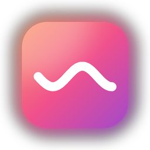
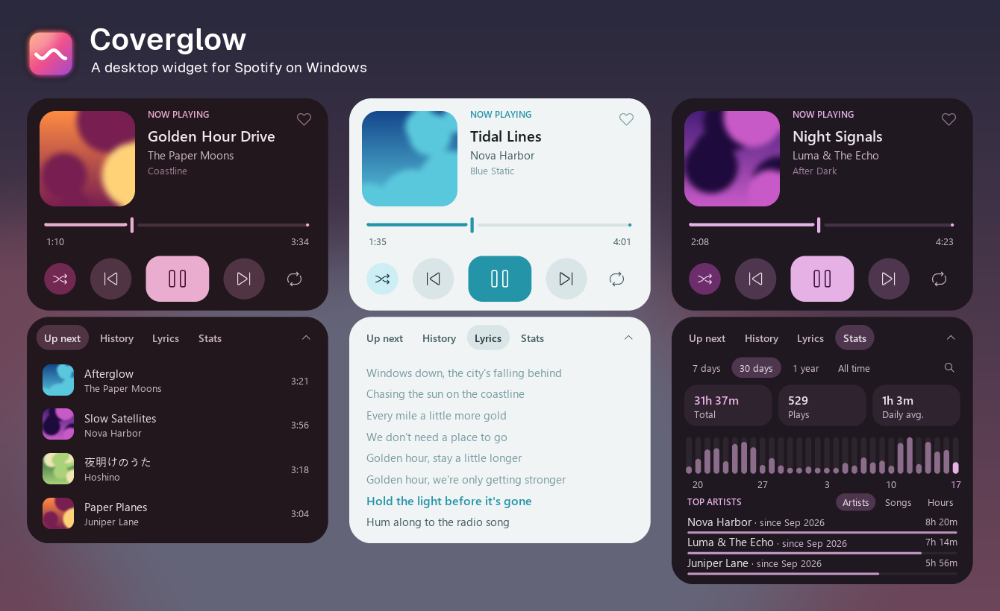
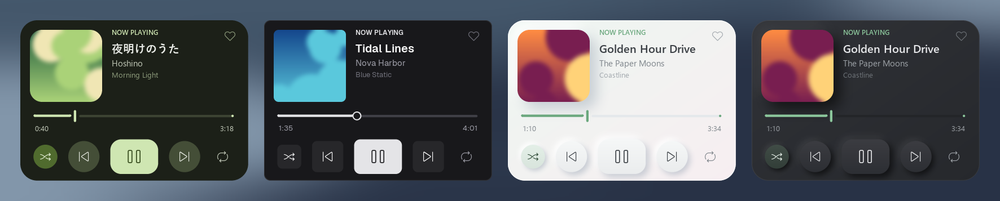
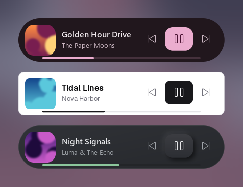
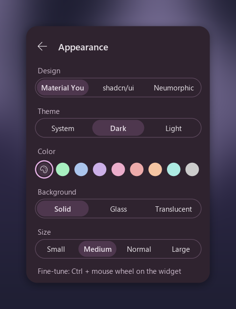

<p align="center">
  
</p>

<h1 align="center">Coverglow</h1>

<p align="center">
  A desktop widget for Spotify on Windows.<br>
  It sits on the desktop below your windows, colors itself from the current album cover (Material You),<br>
  and shows the queue, synced lyrics and your listening stats.
</p>

<p align="center">
  <a href="https://github.com/ryocs15/coverglow/releases/latest"><b>⬇ Download CoverglowSetup.exe</b></a>
  &nbsp;·&nbsp; Windows 10 / 11
</p>



<sub>Screenshots use made-up tracks and generated covers (`tools/screenshots.py`).</sub>

## Features

- **Stays on the desktop** like a Rainmeter skin: it sits below your windows, stays visible after Win+D, and is hidden from the taskbar and Alt+Tab.
- **Material You colors** taken from the album cover, in dark, light or system theme.
- **Controls:** a wavy progress bar you can click, drag or scroll to seek, plus shuffle, repeat, previous/play/next and like. Scroll the mouse wheel over the cover to change Spotify's volume.
- **Tabs**
  - **Up next:** click a track to jump to it.
  - **History:** recently played tracks.
  - **Lyrics:** synced lyrics from [LRCLIB](https://lrclib.net); click a line to seek to it.
  - **Stats:** listening time, plays, streaks, top artists and tracks, and an hour-of-day heat map.
- **Import your Spotify data export** (the zip from *Download your data*) to see stats for your whole history. A yearly **Recap** card summarises each year.
- **Mini mode:** a compact bar with a scrolling title.
- **Three design languages:** Material You, shadcn/ui and Neumorphic (soft UI).
- **Backgrounds:** solid, glass (blurred wallpaper) or translucent.
- **Track toasts**, which also appear on top of fullscreen games.
- **Global hotkeys.**
- **Alarm** and **sleep timer.**
- **Discord ducking:** lowers Spotify while someone is talking.
- **Share card:** copies an image of the current track to the clipboard.
- **Two UI languages:** English and Turkish, picked from the Windows display language.

### Design languages

Material You, shadcn/ui, and Neumorphic in light and dark:



### Mini mode and settings

<p>
  
  &nbsp;
  
</p>

## Download

1. Get `CoverglowSetup.exe` from the [latest release](https://github.com/ryocs15/coverglow/releases/latest).
2. Run it and pick an install folder. No admin rights needed. The setup is unsigned, so SmartScreen may warn the first time: choose *More info → Run anyway*.
3. Coverglow starts after setup and with Windows. Settings, stats and the log are kept in `%APPDATA%\Coverglow`, so they survive updates and reinstalls.

When a new release is out, the menu shows *Update to vX.Y.Z*: one click downloads it, checks it and installs it over the old one, then Coverglow starts again (no browser). You can also run a new setup by hand over the old install. Uninstall from Windows Settings → Apps; it asks whether to delete your settings and stats too (default: keep them).

To quit, right-click the widget and pick **Close** from the menu.

## Requirements

- Windows 10 or 11 with the Spotify desktop app.
- Playback info and controls come from the Windows media API, so **no Spotify account link and no API key are needed** for the basics.
- Linking your Spotify account (optional) adds:
  - the up-next queue
  - like/unlike
  - search
  - track details
  - transfer to device

  Playback control through the Web API needs Spotify Premium.

## Run from source

```bash
pip install -r requirements.txt
```

```bash
python coverglow.py
```

To start it without a console window, use `pythonw coverglow.py`.

## Build the exe

```bash
pip install pyinstaller
```

```bash
python -m PyInstaller --noconfirm Coverglow.spec
```

The output is `dist\Coverglow.exe`. The exe keeps its settings, stats and log in `%APPDATA%\Coverglow` and adds itself to Windows startup; you can turn this off in the menu. Run from source, it keeps them next to `coverglow.py`.

To build the installer, install [Inno Setup 6](https://jrsoftware.org/isinfo.php) and run `ISCC Coverglow.iss`. The output is `dist\CoverglowSetup.exe`.

## Linking your Spotify account (optional)

The widget uses the PKCE flow, so no client secret is stored.

1. Create an app at the [Spotify Developer Dashboard](https://developer.spotify.com/dashboard).
2. Add `http://127.0.0.1:8888/callback` as a Redirect URI.
3. Right-click the widget and choose **Spotify account → Connect Spotify account…**, then paste your app's Client ID.

The refresh token is saved in `config.json`, which is git-ignored. Keep that file private.

## Usage

- **Right click:** open the settings menu.
- **Click the cover:** open Spotify.
- **Click the artist or album:** open its page in Spotify.
- **Ctrl + mouse wheel:** resize the widget.
- **Drag:** move the widget.

### Hotkeys

| Keys | Action |
|---|---|
| Ctrl+Alt+P | Play / pause |
| Ctrl+Alt+→ / ← | Next / previous |
| Ctrl+Alt+↑ / ↓ | Volume up / down |
| Ctrl+Alt+S | Search |
| Ctrl+Alt+L | Like / unlike |

## How it works

- Everything is in one file, `coverglow.py`.
- The widget is drawn with Pillow and pushed to a per-pixel-alpha layered window (`UpdateLayeredWindowIndirect`). Tkinter is only used for events and dialogs.
- Track info comes from the Windows Global System Media Transport Controls (GSMTC) through `winrt`.
- The queue, likes and search use the Spotify Web API.
- Per-app volume and peak meters use `pycaw`.

`CLAUDE.md` has a longer architecture note. Run the tests with:

```bash
python test_core.py
```

## Credits

- [Geist](https://github.com/vercel/geist-font) font by Vercel (SIL Open Font License, see `fonts/Geist-OFL.txt`).
- [Poppins](https://github.com/itfoundry/Poppins) font by the Poppins Project Authors (SIL Open Font License, see `fonts/Poppins-OFL.txt`).
- Lyrics by [LRCLIB](https://lrclib.net).
- shadcn/ui colors from [shadcn-ui/ui](https://github.com/shadcn-ui/ui).

## License

MIT, see [LICENSE](LICENSE). The Geist and Poppins fonts keep their own OFL license.

This is an unofficial project and is not affiliated with Spotify.
